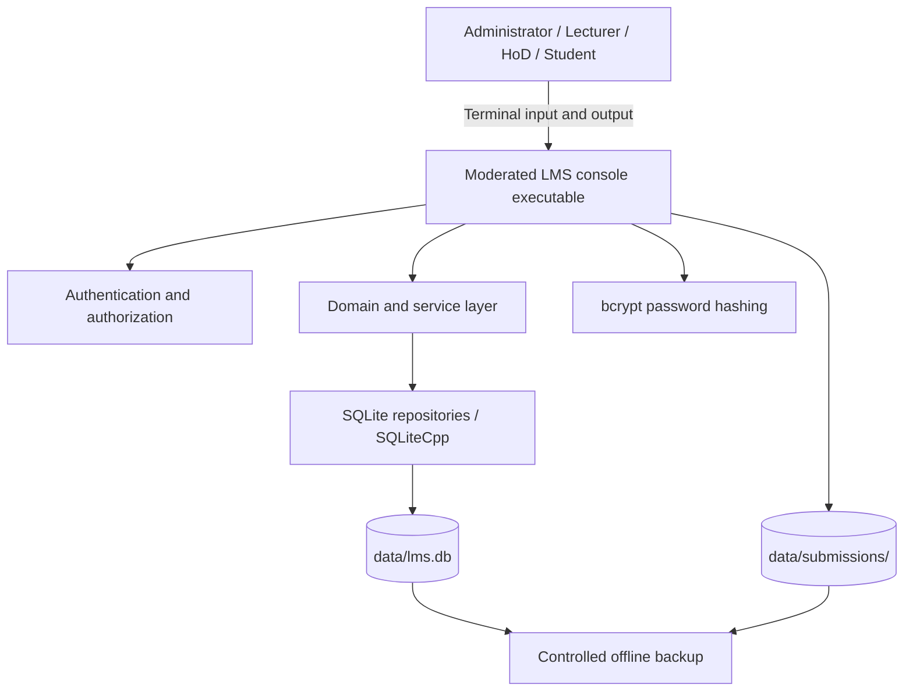

# Moderated LMS 1.0 — Deployment Architecture

## Deployment model

The current release is deployed as a native console process on one trusted workstation or server. The process accesses a local SQLite database file and local submission storage. There is no application server, browser client, network database, or reverse proxy in this deployment.

## Deployment diagram

## Runtime components

| Component | Deployment location | Responsibility |
|---|---|---|
| `lms` executable | Application host | Console interface and workflow orchestration |
| Domain/service code | Linked into executable | LMS rules, role workflows and authorization |
| SQLiteCpp + SQLite | Linked dependencies | Local relational persistence |
| `data/lms.db` | Application data directory | Users, courses, assignments, submissions, marks and audit records |
| `data/submissions/` | Application data directory | Submission files / file references used by the application |
| bcrypt | Linked dependency | Password hash generation and verification |

## Operational controls

- Restrict operating-system access to the executable and `data/` directory.
- Do not commit the live database, submission files, or credentials to source control.
- Change the first-run administrator password immediately.
- Back up the database and submission data together while the application is stopped.
- Test restoration periodically.
- Use one application instance at a time unless concurrency behaviour has been separately validated.

## Scope boundary

This diagram describes the implemented local-console deployment. A future networked deployment would require a service/API boundary, remote authentication/session controls, network transport security, centralized storage and operational monitoring; those components are not claimed as part of version 1.0.
