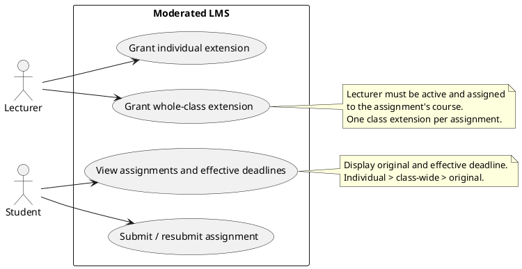
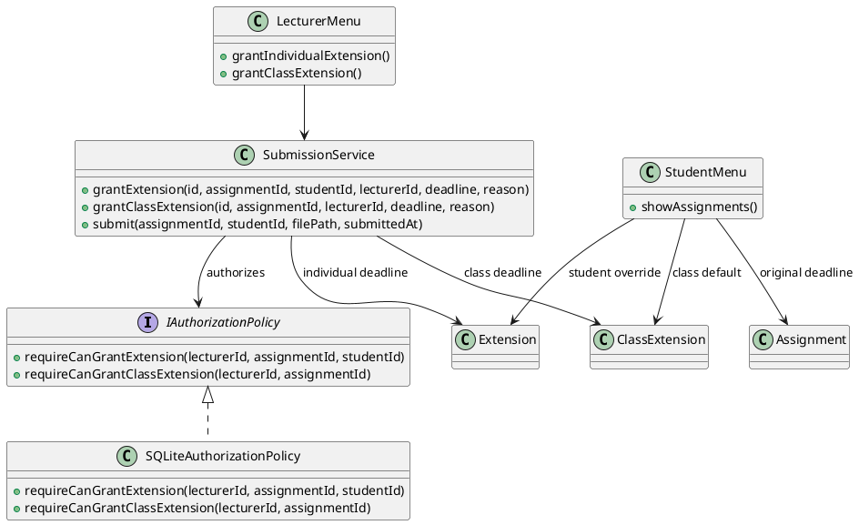

# CR1 design update — v1.1

This document records the design-level changes for CR1. The deployment topology is unchanged: the same local C++ console application and SQLite database are used.

## Updated use cases

## Updated class responsibilities

## Deadline selection rule

For a student and assignment, the effective deadline is:

1. The student's individual extension, when present.
2. Otherwise the assignment's class-wide extension, when present.
3. Otherwise the original assignment deadline.

This ordering intentionally preserves the v1.0 individual-extension behaviour. A class-wide extension is stored separately from individual extensions so that it can be granted once and used by every enrolled student without creating one extension row per student.

## Data model change

`class_extensions` has a unique `assignment_id`, a `granted_by` lecturer reference, `new_deadline`, and `reason`. The existing `extensions` table remains the individual-student override. See the ER relationship diagram in [CR1 change request](change-request-CR1.md).

## Verification mapping

| Design element | Requirement | Verification |
|---|---|---|
| `SubmissionService::grantClassExtension` | FR-06 | UT-CR1-01, UT-CR1-03, IT-CR1-01 |
| `requireCanGrantClassExtension` | FR-06 / security | IT-CR1-04 and authorization unit test |
| `class_extensions` unique per assignment | FR-06 | UT-CR1-03 |
| Deadline precedence | FR-06, FR-08 | UT-CR1-04, IT-CR1-01..03 |
| Student assignment list shows both deadlines | FR-08 | IT-CR1-05 (query/output regression) and ST-CR1-02 |
| Lecturer console class-wide option | FR-06 | ST-CR1-01 |

The deployment diagram does not require an update because no node, process boundary, network link, or external deployment dependency was introduced.
