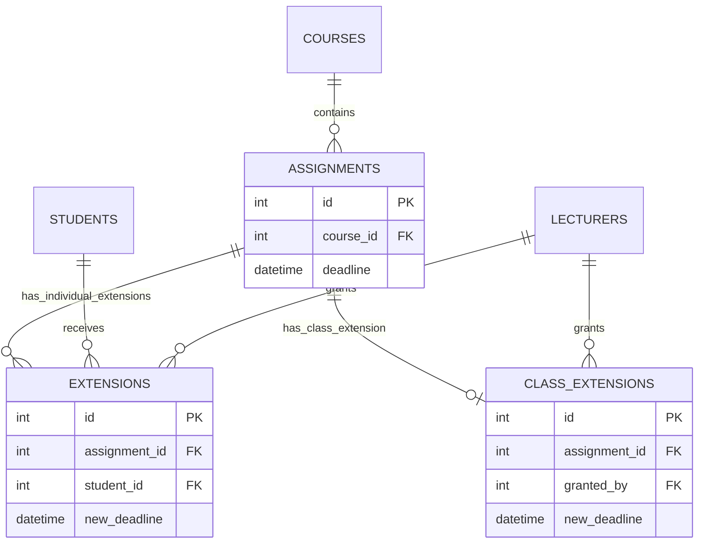

# Phase 8 – Maintenance: Change Request CR1

## 1. Change request

**CR1 (school request):** “A lecturer should be able to extend the deadline for a whole class, not just an individual student, and extensions should be shown on the student's assignment list.”

## 2. Classification and justification

CR1 is **adaptive maintenance**. The existing v1.0 system supports individual deadline extensions, but the school has introduced an additional operational need: applying one extension to every student enrolled in an assignment's course. The change adapts the existing system to that changed requirement. It is not corrective maintenance because the individual-extension behaviour is not itself defective, and it is not preventive maintenance because the primary purpose is not to reduce future faults.

## 3. Impact analysis

| Artefact | Impact | Required update |
|---|---|---|
| Requirement FR-06 / lecturer extension use case | The lecturer extension capability must support individual and whole-class scope | Extend FR-06 and lecturer use-case description; see [CR1 use-case and class design](CR1-design-update.md) |
| Requirement FR-08 / student assignment-list use case | Students must see the deadline that applies to them | Show original and effective deadlines; explain precedence in the student guide |
| Architecture/deployment diagram | No deployment-node or communication change | No deployment topology change; application remains a local C++ console program |
| Detailed design / service classes | `SubmissionService` grants individual and class-wide extensions; `IAuthorizationPolicy` and `SQLiteAuthorizationPolicy` define lecturer permissions | Add `grantClassExtension` and class-extension authorization; calculate the effective deadline |
| Security design / authorization class | Class-wide grants must be restricted to lecturers assigned to the assignment's course | Add `requireCanGrantClassExtension` to authorization policy and SQLite implementation |
| Lecturer menu | Extension operation previously prompted for a student ID | Retain individual extension and add a separate whole-class option |
| Student menu | Assignment list previously selected only `assignments.deadline` | Show original and effective deadline |
| Database / ER model | `extensions` represents one student per assignment | Add `class_extensions`, one row per assignment, with lecturer, deadline and reason |
| Unit tests | Existing tests cover individual extension persistence and deadline calculation | Add class-extension persistence, validation, update and deadline-precedence tests |
| Integration tests | Existing workflow verifies individual extension and late calculation | Verify class-wide deadline applies to multiple enrolled students and individual precedence |
| User documentation | Students previously saw only generic deadline guidance | Explain original versus effective deadline and precedence |

### Database relationship update

The deployment diagram is unchanged because CR1 adds no deployment node or network connection. The database relationship view changes as follows:

### Deadline precedence

The effective deadline is selected in this order:

1. Individual extension for the student, if one exists.
2. Class-wide extension for the assignment, if one exists.
3. Original assignment deadline.

This preserves v1.0 individual-extension behaviour while allowing a class-wide default.

## 4. Implementation in v1.1

- Added `class_extensions` to `db/schema.sql`. It stores one class-wide extension per assignment and records the lecturer, new deadline and reason.
- Added `SubmissionService::grantClassExtension`.
- Added class-extension authorization to `IAuthorizationPolicy` and `SQLiteAuthorizationPolicy`. The lecturer must be active and assigned to the assignment's course.
- Updated submission deadline calculation to use the individual, class-wide or original deadline according to the precedence above.
- Added a whole-class extension option to the lecturer menu while retaining individual extensions.
- Updated the student assignment list to display both the original and effective deadline.
- Updated the student guide to explain which deadline applies.

## 5. Regression test plan and traceability

| Test ID | Test | Expected result |
|---|---|---|
| UT-CR1-01 | Grant a valid class extension | Extension is saved for the assignment |
| UT-CR1-02 | Missing deadline or blank reason | Request is rejected |
| UT-CR1-03 | Update an existing class extension | One row remains for the assignment with updated values |
| UT-CR1-04 | Individual and class extension both exist | Individual deadline takes precedence |
| IT-CR1-01 | Submit before class-extended deadline without individual extension | Submission is on time |
| IT-CR1-02 | Two or more enrolled students submit before the same class-extended deadline | Class extension applies to every enrolled student |
| IT-CR1-03 | No extension exists | Original deadline remains effective |
| IT-CR1-04 | Unassigned or inactive lecturer attempts a class extension | Authorization denies operation and no row is written |
| ST-CR1-01 | Lecturer grants a whole-class extension in console | Lecturer can choose class scope and provide deadline/reason |
| ST-CR1-02 | Student views assignment list | Original and effective deadlines are visible; effective deadline follows precedence |
| REG-CR1-01 | Existing individual-extension and complete regression suites | Existing behaviour remains unchanged and all tests pass |

The student assignment-list output must be tested directly (not inferred only from the submission service's deadline calculation). Test execution status and evidence must be recorded in the test execution report and the CI run.

## 6. Release record

**Target release:** v1.1  
**Change request:** CR1  
**Implementation status:** Feature implementation is present in the maintenance branch; design and student documentation updates are recorded in this change set.  
**Regression status:** Not yet verified by this documentation change. Record actual CTest, platform CI, coverage and static-analysis results before declaring v1.1 release-ready.  
**Release tag:** Create `v1.1` only after all required checks pass and the release record is updated with the actual evidence.
