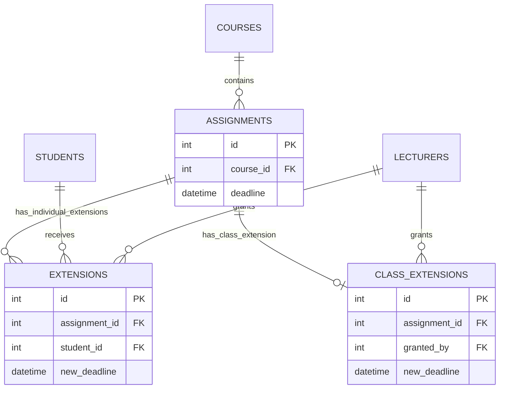

# Phase 8 – Maintenance: Change Request CR1

## 1. Change request

**CR1 (school request):** “A lecturer should be able to extend the deadline for a whole class, not just an individual student, and extensions should be shown on the student's assignment list.”

## 2. Classification and justification

CR1 is **adaptive maintenance**. The existing v1.0 system supports individual deadline extensions, but the school has introduced an additional operational need: applying one extension to every student enrolled in an assignment's course. The change adapts the existing system to that changed requirement. It is not corrective maintenance because the individual-extension behaviour is not itself defective, and it is not preventive maintenance because the primary purpose is not to reduce future faults.

## 3. Impact analysis

| Artefact | Impact | Required update |
|---|---|---|
| Requirement FR-06 / lecturer extension use case | The lecturer extension capability must support individual and whole-class scope | Extend FR-06 and the lecturer use-case description to include class-wide extensions |
| Student assignment-list requirement / use case | Students must be able to see the deadline that applies to them | Display original and effective deadlines in the assignment list |
| Architecture/deployment diagram | No deployment-node or communication change | No deployment topology change; the application remains a local C++ console program |
| Detailed design / service classes | `SubmissionService` currently grants an extension to one student; `IAuthorizationPolicy` and `SQLiteAuthorizationPolicy` define lecturer permissions | Add `grantClassExtension` and class-extension authorization; calculate the effective deadline |
| Security design / authorization class | Class-wide grants must be restricted to lecturers assigned to the assignment's course | Add `requireCanGrantClassExtension` to the authorization policy and SQLite implementation |
| Lecturer menu | `LecturerMenu` extension operation prompts for a student ID | Retain individual extension and add a separate whole-class option |
| Student menu | `StudentMenu` assignment list currently selects only `assignments.deadline` | Show original deadline and effective deadline |
| Database | `extensions` represents one student per assignment | Add `class_extensions`, one row per assignment, with lecturer, deadline and reason |
| Unit tests | Existing tests cover individual extension persistence and deadline calculation | Add class-extension persistence, validation, update and deadline-precedence tests |
| Integration tests | Existing workflow verifies individual extension and late calculation | Add a whole-class extension workflow test |

### Database relationship update

The deployment diagram is unchanged because CR1 adds no deployment node or network connection. The database relationship view changes as follows:

### Deadline precedence

The effective deadline is selected in this order:

1. Individual extension for the student, if one exists.
2. Class-wide extension for the assignment, if one exists.
3. Original assignment deadline.

This preserves v1.0 individual-extension behaviour while allowing a class-wide default.

## 4. Implementation in v1.1

- Added `class_extensions` to `db/schema.sql`. It stores one class-wide extension per assignment and records the lecturer, new deadline and reason.
- Added `SubmissionService::grantClassExtension`.
- Added class-extension authorization to `IAuthorizationPolicy` and `SQLiteAuthorizationPolicy`. The lecturer must be active and assigned to the assignment's course.
- Updated submission deadline calculation to use the individual, class-wide or original deadline according to the precedence above.
- Added a whole-class extension option to the lecturer menu while retaining individual extensions.
- Updated the student assignment list to display both the original and effective deadline.

## 5. Regression test plan

| Test | Expected result |
|---|---|
| Class extension has valid deadline and reason | Extension is saved for the assignment |
| Missing deadline or blank reason | Request is rejected |
| Existing class extension is updated | One row remains for the assignment with the new values |
| Student submits before the class-extended deadline | Submission is on time |
| Individual extension and class extension both exist | Individual deadline takes precedence |
| No extensions exist | Original assignment deadline remains effective |
| Unassigned lecturer attempts a class extension | Authorization denies the operation |
| Existing individual-extension tests | Continue to pass unchanged |
| Existing full test suite | All prior tests continue to pass |

## 6. Release record

**Target release:** v1.1  
**Change request:** CR1  
**Implementation status:** Implemented in the maintenance working copy.  
**Regression status:** Pending execution of the complete test suite in an environment with the bundled GoogleTest dependency available.
